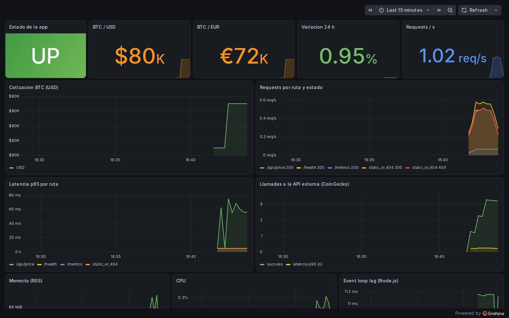
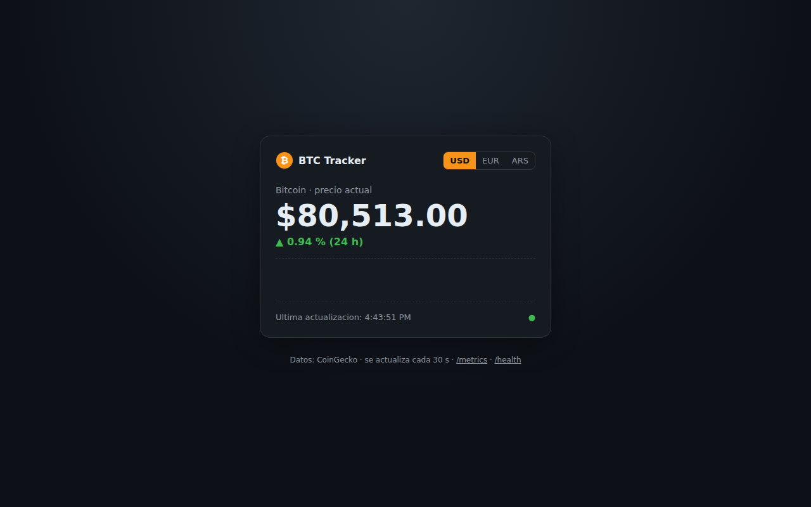

# Proyecto 1 — CI/CD con GitHub Actions + Terraform + Docker

**Equipo:** EquipoX — Jose Antonio Zerda
**Aplicacion:** BTC Tracker, una pagina web que muestra la cotizacion de Bitcoin (USD / EUR / ARS) en tiempo real,
con la variacion de las ultimas 24 h. Generada con IA (Claude) y desplegada en contenedores Docker.

| | |
|---|---|
| Repositorio | https://github.com/josezerda/btc-tracker |
| Pipeline (GitHub Actions) | https://github.com/josezerda/btc-tracker/actions |
| Imagen publicada (GHCR) | `ghcr.io/josezerda/btc-tracker:latest` |
| Analisis de calidad (SonarQube Cloud) | https://sonarcloud.io/project/overview?id=josezerda_btc-tracker |
| Analisis de seguridad | Snyk (organizacion `josezerda`) |

---

## Arquitectura

```
                GitHub Actions (CI/CD)
  push ──► build/test ──► SonarQube + Snyk + Terraform validate ──► Docker build + escaneo + SBOM ──► deploy
                                                                                                       │
                                                                                          terraform apply
                                                                                                       ▼
  Navegador ──► BTC Tracker (Node.js/Express, contenedor) ──► API CoinGecko
                     │ /metrics
                     ▼
                Prometheus ──► Grafana (dashboard aprovisionado)
```

Toda la infraestructura (red, volumenes y los 3 contenedores) se crea con **Terraform**
usando el provider `kreuzwerker/docker`.

---

## Entregables

| Entregable solicitado | Ubicacion |
|---|---|
| Workflow `.yml` de GitHub Actions | [`.github/workflows/ci-cd.yml`](.github/workflows/ci-cd.yml) |
| Archivos Terraform `.tf` | [`terraform/local/`](terraform/local/) (`versions.tf`, `variables.tf`, `main.tf`, `outputs.tf`) |
| `Dockerfile` | [`Dockerfile`](Dockerfile) |
| Artefacto generado | `artefacto/btc-tracker-image.tar.gz` (imagen Docker exportada por el pipeline) y `ghcr.io/josezerda/btc-tracker` |
| SBOM CycloneDX | `sbom/sbom-image.cdx.json` (imagen) y `sbom/sbom-npm.cdx.json` (dependencias) |
| SBOM SPDX | `sbom/sbom-image.spdx.json` |
| Captura del dashboard de metricas | `capturas/grafana-dashboard.png` |

---

## Resultados

### Pipeline exitoso
Todos los jobs en verde: build y tests, SonarQube, Snyk, Terraform, Docker y despliegue con Terraform.


### Dashboard de metricas (Prometheus + Grafana)
Captura generada automaticamente por el job `deploy` despues de levantar el stack con Terraform.



Metricas mostradas: estado de la app, cotizacion BTC (USD/EUR), variacion 24 h, requests por segundo,
latencia p95, llamadas a la API externa, memoria, CPU y event loop de Node.js.

### Aplicacion


---

## Controles de seguridad en el pipeline

| Control | Herramienta | Criterio de corte |
|---|---|---|
| Lint / calidad de codigo | ESLint | cualquier error |
| Tests unitarios + cobertura | Jest (13 tests) | cualquier fallo |
| Analisis estatico + Quality Gate | SonarQube Cloud | Quality Gate "Sonar way" |
| Vulnerabilidades en dependencias | `npm audit` + Snyk Open Source | severidad alta |
| Analisis de codigo (SAST) | Snyk Code | severidad alta |
| Infraestructura como codigo | `terraform validate` + Snyk IaC | severidad alta |
| Vulnerabilidades de la imagen | Grype + Snyk Container | severidad critica |
| Inventario de componentes | SBOM CycloneDX + SPDX (Syft) | — |

Endurecimiento adicional: imagen multi-stage, usuario no root, sin npm/yarn en runtime,
contenedor *read-only*, `cap_drop: ALL`, `no-new-privileges`, cabeceras de seguridad con Helmet (CSP).

### Caso real: el pipeline bloqueo un despliegue vulnerable

1. Snyk detecto vulnerabilidades en la imagen base `node:22-alpine` (1 critica, 2 altas)
   y abrio automaticamente un pull request para actualizarla a `node:26.5.0-alpine`.
2. Al integrarlo, el paso **Snyk Container** encontro **2 vulnerabilidades criticas** en Node 26.5.0
   (*Directory Traversal* y *Out-of-bounds Write*) y **detuvo el pipeline antes del despliegue** (corrida #4).
3. Se actualizo la imagen base a `node:26.12.1-alpine`, que corrige ambas.
   El pipeline volvio a pasar (corrida #5) y las alertas en GitHub Security bajaron de 13 a 3.


| SonarQube Cloud | Snyk |
|---|---|
|  |  |

---

## Etapas del pipeline

1. **build-test**: `npm ci`, ESLint, Jest con cobertura, `npm audit`, SBOM de dependencias.
2. **sonarqube**: analisis estatico con cobertura y espera del Quality Gate.
3. **snyk**: dependencias (`snyk test`) y codigo (`snyk code test`).
4. **iac**: `terraform fmt`, `terraform validate` y `snyk iac test`.
5. **docker**: build, prueba del contenedor, escaneo con Grype y Snyk Container, SBOM CycloneDX + SPDX,
   exportacion de la imagen como artefacto y publicacion en GitHub Container Registry.
6. **deploy**: `terraform plan/apply` del stack completo, smoke tests, generacion de trafico,
   captura del dashboard y `terraform destroy` (entorno efimero).
7. **deploy-vm** *(opcional)*: el mismo despliegue, persistente, en la VM de VirtualBox mediante un runner self-hosted.

---

## Como ejecutarlo localmente (opcion VirtualBox)

Requisitos: VirtualBox y Vagrant.

```bash
vagrant up            # VM Ubuntu 24.04 con Docker y Terraform
vagrant ssh
cd /vagrant
docker build -t btc-tracker:latest .

cd terraform/local
cp terraform.tfvars.example terraform.tfvars   # definir password de Grafana y app_image = "btc-tracker:latest"
terraform init
terraform apply
```

| Servicio | URL |
|---|---|
| App | http://localhost:3000 |
| Prometheus | http://localhost:9090 |
| Grafana | http://localhost:3001 (usuario `admin`) |

Para destruir el entorno: `terraform destroy`.

Alternativa rapida sin VM: `GRAFANA_ADMIN_PASSWORD='...' docker compose up --build`.

---

## Endpoints de la aplicacion

| Ruta | Descripcion |
|---|---|
| `/` | Pagina web |
| `/api/price` | Cotizacion en JSON (cache de 30 s para respetar el rate limit de CoinGecko) |
| `/health` | Healthcheck (usado por Docker y Terraform) |
| `/metrics` | Metricas en formato Prometheus |

---

## Estructura del proyecto

```
.github/workflows/ci-cd.yml    Pipeline CI/CD
Dockerfile, .dockerignore      Imagen del contenedor
src/, public/, tests/          Aplicacion y tests
terraform/local/               Infraestructura como codigo
monitoring/                    Prometheus + Grafana (datasource y dashboard)
sbom/                          SBOM CycloneDX y SPDX
capturas/                      Dashboard, pipeline y evidencias de seguridad
artefacto/                     Imagen Docker exportada (.tar.gz)
Vagrantfile                    VM de VirtualBox con Docker + Terraform
docker-compose.yml             Stack para desarrollo
```

## Opcion nube (AWS)

El mismo enfoque aplica cambiando el provider de Terraform: una instancia EC2 o un servicio ECS Fargate
creado con `hashicorp/aws`, el estado en un backend `s3`, y el pipeline autenticandose con OIDC
(`aws-actions/configure-aws-credentials`) en lugar de credenciales fijas.
